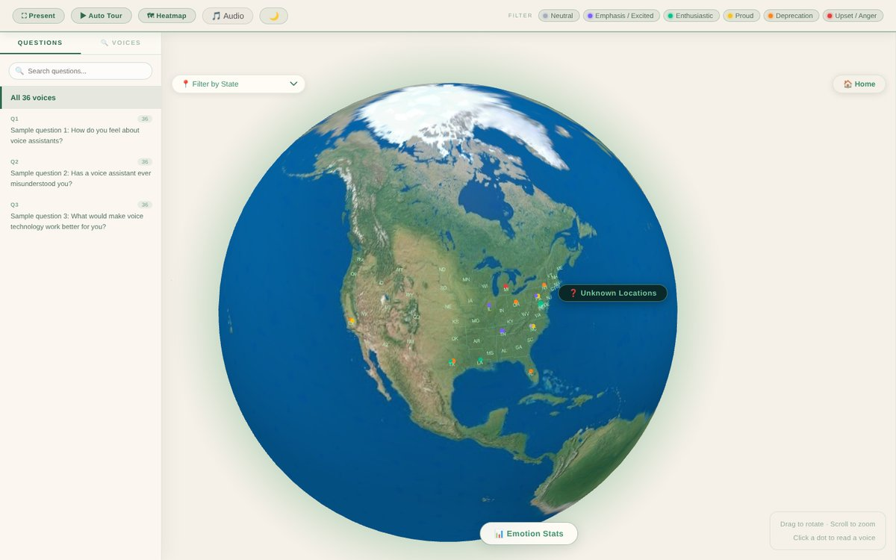

# AAVE-Voices

> Public version of the interactive globe I built for the Elevate Black Voices research project at Howard University's Human-Centered AI Institute. The research data is confidential, so this version runs on made-up sample data.



An interactive React data visualization that maps **AAVE (African American Vernacular English) interview voices** onto a 3D globe. Each respondent appears as a point placed by their U.S. location and colored by the emotion/sentiment of their response. You can browse by question, search individual voices, view stats and heatmaps, and play back location-based audio clips.

The app is built with **React 19** and **Vite**, renders the globe with **globe.gl / three.js**, and loads its source data directly from an Excel workbook in the browser using **SheetJS (xlsx)**.

---

## Prerequisites

The same commands work on **macOS, Windows, and Linux**.

- **Node.js 20.19+ or 22.12+** (the project is tested on Node 24). Check with:
  ```bash
  node --version
  ```
  If you need Node, download it from [nodejs.org](https://nodejs.org/).
  - **macOS:** you can also install it with [Homebrew](https://brew.sh/): `brew install node`
- **npm** (ships with Node).

> **Windows / PowerShell note:** If `npm install` fails with a `PSSecurityException` / "running scripts is disabled" error, either run the commands in **Command Prompt (cmd)**, use `npm.cmd` instead of `npm`, or relax the execution policy for your user:
> ```powershell
> Set-ExecutionPolicy -Scope CurrentUser RemoteSigned
> ```
> This note does **not** apply to macOS or Linux — the standard `npm` commands below work as-is.

---

## Run the app (3 steps)

These steps are identical on macOS, Windows, and Linux. From the project root (`AAVE-Voices/`):

### 1. Install dependencies

```bash
npm install
```

### 2. Start the development server

```bash
npm run dev
```

Vite prints a local URL — open it in your browser:

```
➜  Local:   http://localhost:5173/
```

The page loads the dataset, renders the globe, and shows the intro screen. Changes you make to the source code hot-reload automatically.

### 3. Stop the server

Press `Ctrl + C` in the terminal.

---

## Other commands

| Command           | What it does                                                        |
| ----------------- | ------------------------------------------------------------------- |
| `npm run dev`     | Start the local dev server with hot reload (use this for development).|
| `npm run build`   | Create an optimized production build in `dist/`.                    |
| `npm run preview` | Serve the production build locally to preview it.                  |
| `npm run lint`    | Run ESLint across the project.                                     |

To build and preview a production bundle:

```bash
npm run build
npm run preview
```

---

## Where the data comes from

The real research data (survey responses, transcripts, and audio) is confidential and is **not** in this repository.
This public version runs on **made-up sample data** so you can see how the app works:

- **`public/sample-data.xlsx`** has 36 fake respondents with placeholder answers. The app reads the
  `p1 cleaned`, `p2 cleaned`, and `p3 cleaned` sheets and groups rows by `SessionID`
  into individual respondents (see [src/data/useRespondents.js](src/data/useRespondents.js)).
- **`public/Memojis/`** has the memoji avatars shown for respondents.
- **`public/audio/map-data/v1/manifest.json`** is an empty audio manifest. Location audio playback
  has no clips in this version.

To use your own dataset, drop an `.xlsx` with the same column names into `public/` and update
the filename passed to `useRespondents('/sample-data.xlsx')` in [src/App.jsx](src/App.jsx).

---

## Project structure

```
AAVE-Voices/
├── index.html                  # Vite entry HTML
├── package.json                # Scripts & dependencies
├── vite.config.js              # Vite + React plugin config
├── public/
│   ├── sample-data.xlsx        # Made-up sample dataset (loaded at runtime)
│   ├── Memojis/                # Memoji avatar images
│   └── audio/                  # Audio manifest (empty in this version)
├── src/
│   ├── main.jsx                # React entry point
│   ├── App.jsx                 # Main app: globe, panels, search, playback
│   ├── index.css               # Global styles
│   ├── components/
│   │   └── Globe.jsx           # 3D globe rendering (globe.gl / three.js)
│   ├── data/
│   │   └── useRespondents.js   # Loads & parses the Excel dataset
│   └── features/
│       └── map-audio/
│           └── MapAudio.jsx    # Location-based audio playback
└── sentiment_analysis/         # Optional Python data-prep (see below)
```

---

## Optional: sentiment analysis pipeline

The `sentiment_analysis/` folder contains a standalone **Python** script that was used to analyze
transcript sentiment/emotion (using Hugging Face transformer models, cached in `hf_model_cache/`).
This is **not required to run the React app** — the app uses the already-processed values in the
Excel workbook. The folder is included for reproducibility of the data-prep step.

To run it (optional):

```bash
cd sentiment_analysis
pip install transformers torch pandas
python sentiment_analysis.py
```

> On macOS/Linux you may need to use `python3` and `pip3` instead of `python` and `pip`.

Outputs (`sentiment_results.csv`, `sentiment_summary.txt`, and a comparison chart) are written
alongside the script. Results from the real research data are not included.

---

## Tech stack

- **React 19** + **Vite 8** — UI and build tooling
- **globe.gl** / **three.js** — 3D globe rendering
- **framer-motion** — animations
- **SheetJS (xlsx)** / **papaparse** — in-browser data parsing
- **ESLint** — linting
